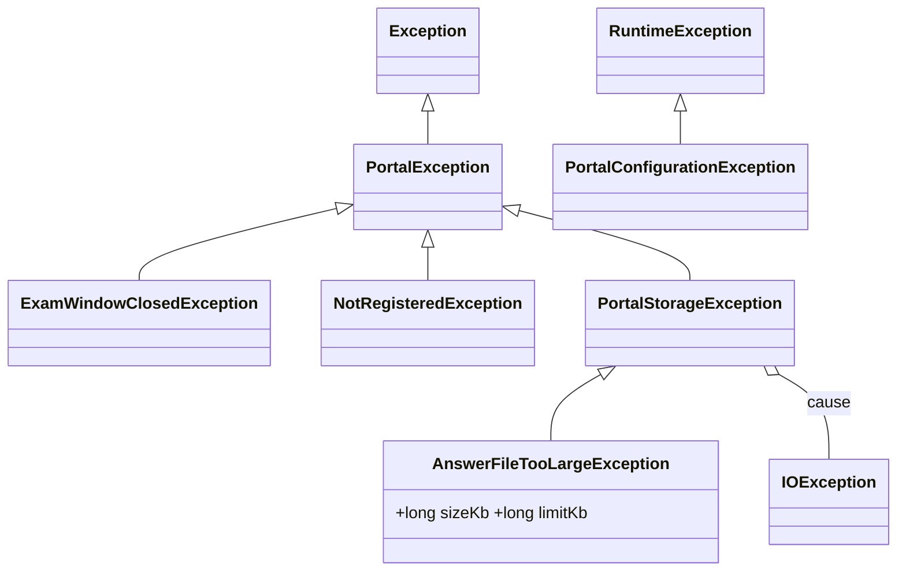

# Q2: User-Defined Exceptions and Propagation in an Online Examination Portal

**Programs:** `StorageDemo.java` (Complete the Code), `ExamPortal.java` (three layers, scenarios, chaining, cost)
**Run:** `javac *.java && java StorageDemo && java ExamPortal` · **Outputs:** `output/`

## Complete the Code
```java
} catch (IOException e) {
    // TODO 1 (completed)
    throw new SubmissionStorageException("Could not store " + fileName, e);   // e kept as the cause
}
```
Output (matches the expected output):
```
Saved answer01.pdf
Error: Could not store answer02.pdf
Cause: Disk quota exceeded
```
**If the IOException were not passed to the constructor:** `e.getCause()` would return `null`, so `e.getCause().getMessage()` would throw a **`NullPointerException`**. The program would print the Error line and then crash with an NPE stack trace instead of the Cause line. Even with a null check, the real reason ("Disk quota exceeded") would be gone. `ExamPortal` shows this: re-thrown without its cause, `getCause() -> null`.

## Shared work: hierarchy, layers, chaining
```
Exception
 └─ PortalException                    (checked)  base: "submission rejected"
     ├─ ExamWindowClosedException      (checked)  service layer
     ├─ NotRegisteredException         (checked)  service layer
     └─ PortalStorageException         (checked)  storage layer; wraps IOException as its cause
         └─ AnswerFileTooLargeException (checked) storage layer; carries sizeKb and limitKb
RuntimeException
 └─ PortalConfigurationException      (unchecked) bug/configuration error, e.g. registrations not loaded
```
`StorageLayer.store() throws PortalStorageException` → `SubmissionService.submit() throws PortalException` → `SubmissionController.handle()` catches and turns each into a message for the student.

## Student A: hierarchy and propagation design

**Checked or unchecked:** every rule violation (window closed, not registered, file too large, disk failure) is **checked**. These are expected, recoverable business outcomes that the controller *must* handle and show to the student, and `throws` makes each layer declare them. `PortalConfigurationException` is **unchecked**: a missing registration table is a deployment bug that no caller can fix at run time, so forcing every method to declare it would just add noise.

**Propagation path (disk full):**
```
StorageLayer.writeToDisk  throws IOException("No space left on device")
   ↓ caught in StorageLayer.store → wrapped: new PortalStorageException("Could not store ans.pdf for 192311001", e)
   ↓ declared by store() throws PortalStorageException
SubmissionService.submit   does not catch → propagates (throws PortalException)
   ↓
SubmissionController.handle  catch (PortalStorageException e) → log(e) with full chain → returns a message
```
**Where it is handled and what the student sees:** only in the controller. The full chain goes to the server log. The student sees: *"We could not save your answers right now. Please try again in a few minutes."* No disk paths, no IOException text.

## Student B: scenarios and chaining evidence
| Scenario | Exception | Student sees (observed) |
|---|---|---|
| S1 valid | none | Submitted successfully. |
| S2 window closed | `ExamWindowClosedException` | Submission rejected: the exam window has closed. |
| S3 not registered | `NotRegisteredException` | …you are not registered for this course. |
| S4 900 KB file | `AnswerFileTooLargeException` | …your file is 900 KB (maximum 500 KB). Please compress it. |
| S5 disk full | `PortalStorageException` ← `IOException` | We could not save your answers right now… (chain logged) |
| S6 registration table missing | `PortalConfigurationException` (unchecked) | not caught by the controller: escapes as a bug |

**Chained stack trace (cause kept):**
```
ExamPortal$PortalStorageException: Could not store ans.pdf for 192311001
    at ExamPortal$StorageLayer.store(ExamPortal.java:54)
    at ExamPortal$SubmissionService.submit(ExamPortal.java:78)
    at ExamPortal.main(ExamPortal.java:140)
Caused by: java.io.IOException: No space left on device (/exam-store, 0 bytes free)
    at ExamPortal$StorageLayer.writeToDisk(ExamPortal.java:59)
    at ExamPortal$StorageLayer.store(ExamPortal.java:52)
    ... 2 more
getCause() -> java.io.IOException: No space left on device (/exam-store, 0 bytes free)
```
**Re-thrown without the cause:** the `Caused by:` section disappears, `getCause()` is `null`, and the trace starts at `store()`. **Lost:** the real reason (disk full, not a bad file), the device and free space, and the frame where the I/O actually failed (`writeToDisk:59`). An operator could not tell a full disk from a permissions or network problem.

## Joint conclusion
A `SubmissionStorageException` (our `PortalStorageException`) speaks the **portal's language**: "this submission could not be stored", together with the student and file. It is part of the method's contract (checked, declared), so the controller can map it to a helpful message. A raw `IOException` reaching the UI would (1) **leak internals** such as paths, device names and stack details to students; (2) **couple** the UI to the storage technology, so changing from files to a database changes the exception types the UI must know about; and (3) give an unhelpful message ("No space left on device"). Chaining keeps the technical cause for the log, so nothing is lost for debugging.

## Alternative concept: unchecked custom exceptions
```java
static class PortalException extends RuntimeException { ... }     // instead of Exception
void store(...) { ... }                     // no "throws" clause needed anywhere
void submit(...) { ... }                    // compiler no longer forces callers to catch
String handle(...) { try { ... } catch (PortalException e) { ... } }   // still possible, now optional
```
**What changes:** the `throws` clauses disappear from every signature, and callers *may* catch but are not forced to. The risk is that a new caller (say, a mobile API) forgets the handler, and an unchecked exception becomes a 500 error. Checked gives compile-time completeness; unchecked gives less boilerplate, works well with lambdas and streams, and is common in frameworks.

**Cost of capturing a stack trace (measured):**
| call depth d | create + materialise trace | without trace capture | frames held |
|---|---|---|---|
| 1 | ≈ 2,184 ns | ≈ 26 ns | 5 |
| 10 | ≈ 4,055 ns | ≈ 34 ns | 14 |
| 50 | ≈ 13,160 ns | ≈ 159 ns | 54 |
| 200 | ≈ 46,338 ns | ≈ 1,038 ns | 204 |

Time and space are both **O(d)**: `fillInStackTrace()` walks d frames and stores d `StackTraceElement`s (each ≈ 50–100 B once materialised). Checked or unchecked makes **no difference** to this cost. **Chaining:** each wrapper holds a reference to its cause, so an exception chain of length k keeps **all k exception objects and all their traces** reachable: O(k·d) memory per top-level exception, until it is garbage-collected. That is fine for occasional failures, but chains should not be stored in long-lived collections.
