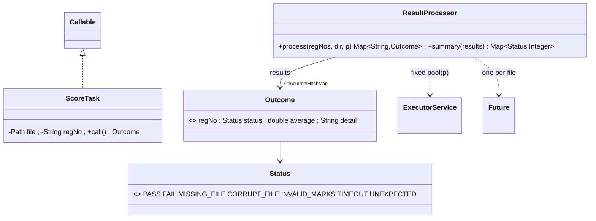

# Q7: Design a Concurrent, Fault-Tolerant Processor from First Principles

**Program:** `ResultProcessor.java` (generates its own test files under `data/`)
**Run:** `javac ResultProcessor.java && java ResultProcessor` · **Output:** `output/ResultProcessor.txt` / `.png`

## Stage 1: interpret the problem (joint)
- **Parallel tasks:** reading, validating and computing **one student's** result depends only on that student's file, so the 10,000 files are 10,000 independent tasks. **Shared data:** the result table (written by all tasks) and the summary counters (built after all tasks finish).
- **Failures and handling:**

| Failure | Detected by | Handling |
|---|---|---|
| file missing | `NoSuchFileException` | outcome MISSING_FILE; the run continues |
| corrupt: non-numeric mark, wrong number of marks, wrong regNo header | `NumberFormatException` / checks | outcome CORRUPT_FILE with the reason |
| mark outside 0..100 | range check | outcome INVALID_MARKS |
| other I/O error | `IOException` | CORRUPT_FILE with the exception text |
| a bug inside a task (any RuntimeException) | `ExecutionException` from `Future.get` | UNEXPECTED; the run continues |
| a hung read | `Future.get(5, SECONDS)` timeout | TIMEOUT; the task is cancelled |

- **Measurable requirements:** R1: every input file gets **exactly one** outcome (10,000 in, 10,000 out). R2: summary counts equal the injected counts exactly. R3: one bad file never stops the run (0 aborted runs). R4: 10,000 files are processed in **< 1 s** with simulated network-share latency (400 µs per file), versus about 5.3 s sequentially. R5: the summary is printed only after all tasks are resolved.

## Stage 2: design (Student A)

```
process(regNos, dir, p):
    pool    ← newFixedThreadPool(p)
    results ← new ConcurrentHashMap<regNo, Outcome>
    futures ← [ pool.submit(new ScoreTask(dir/reg.txt, reg)) for reg in regNos ]     // all submitted first
    for i in 0 .. n-1:                                   // then collect, in input order
        try   o ← futures[i].get(5 s)                    // wait for THIS file only
        catch ExecutionException e  → o ← Outcome(reg, UNEXPECTED, e.cause)
        catch TimeoutException      → futures[i].cancel(true); o ← Outcome(reg, TIMEOUT)
        results.put(reg, o)                              // every file gets exactly one entry
    finally pool.shutdown(); awaitTermination
    return results

ScoreTask.call():          // NEVER throws for expected failures - converts them into an Outcome
    try   read lines; validate header, 5 marks, range; compute avg & PASS/FAIL
    catch NoSuchFileException → MISSING_FILE ; NumberFormatException/IOException → CORRUPT_FILE
```
- **ExecutorService + Callable + Future:** a fixed pool reuses p threads for 10,000 tasks. `Callable` returns a value (a Runnable cannot). `Future` lets the collector wait for, time out or cancel each file individually.
- **Concurrent collection: `ConcurrentHashMap`.** Many threads may insert at once without a global lock (writes lock per bin, reads take no lock), and it gives O(1) lookup of a student's result. A `Collections.synchronizedMap` would serialise every insert; a plain `HashMap` can corrupt itself under concurrent writes. The summary is built from it afterwards.
- **One failure never stops the run:** expected failures become *values* (an `Outcome` with a status), not exceptions. Unexpected ones are caught per Future (`ExecutionException`), so an exception in one task is wrapped in *that* Future only.

## Stage 3: implement and measure (Student B)
**Hand-checked set** (10 files, built to hit every status):
| File | Content | Expected by hand | Program |
|---|---|---|---|
| S01 | 80,75,90,60,70 | PASS (avg 75) | PASS |
| S02 | 45,50,55,60,40 | PASS (avg 50, min 40: boundary) | PASS |
| S03 | 90,90,90,90,39 | FAIL (a mark < 40) | FAIL |
| S04 | 50,50,50,50,49 | FAIL (avg 49.8) | FAIL |
| S05 | (missing) | MISSING_FILE | MISSING_FILE |
| S06 | 70,7O,80,90,60 | CORRUPT (letter O) | CORRUPT_FILE |
| S07 | 70,80,90 | CORRUPT (3 marks) | CORRUPT_FILE |
| S08 | header S99 | CORRUPT (regNo mismatch) | CORRUPT_FILE |
| S09 | …101… | INVALID_MARKS | INVALID_MARKS |
| S10 | 100 ×5 | PASS | PASS |
Summary `PASS 3, FAIL 2, MISSING 1, CORRUPT 3, INVALID 1`: **MATCH**.

**10,000 files** with **103 missing, 111 corrupt and 47 invalid** injected (every 97th, 89th and 211th file):
| pool p | A) 400 µs latency per file (I/O-bound) | speed-up | B) local disk, CPU-bound (2 cores) | speed-up | counts 103/111/47, 10,000 outcomes? |
|---|---|---|---|---|---|
| 1 | 5,340 ms | 1.0× | 172 ms | 1.0× | yes |
| 2 | 2,615 ms | 2.0× | 83 ms | 2.1× | yes |
| 4 | 1,291 ms | 4.1× | 60 ms | 2.8× | yes |
| 8 | **641 ms** | 8.3× | 62 ms | 2.8× | yes |
| 16 | 335 ms | 15.9× | 54 ms | 3.2× | yes |
| 32 | 177 ms | 30.2× | 71 ms | **2.4× (slower than 16)** | yes |

**Failures not handled correctly:** none. Every run produced exactly 10,000 outcomes with the injected counts, 0 UNEXPECTED and 0 TIMEOUT. If a future bug let an exception escape `call()`, it would surface as an UNEXPECTED outcome through `ExecutionException` instead of stopping the run.

## Stage 4: defend the design (joint)
- **Recommended pool size:** it depends on what limits the work. For **I/O-bound** reads (a network share, which is the realistic case), threads spend most of their time waiting, so p ≈ cores × (1 + wait/compute) works: here **p = 8–16** meets R4 (< 1 s) with a modest thread count. For **CPU-bound** local processing, **p ≈ number of cores (2 here)**: beyond 2 threads the speed-up flattened at about 2.8×, and **32 threads were slower than 16**. Extra threads only add context switches and contention without adding cores. That is why more threads did not always help.
- **Complete and correct summary:** (1) one Future per input file, collected by *index*, so exactly one `results.put` per file (R1); (2) every path through `call()` returns an Outcome, and the collector converts `ExecutionException` and `TimeoutException` into Outcomes too, so there is no path that loses a file; (3) the summary is computed only after the collection loop has resolved **every** Future (`get` is a happens-before edge, so all results are visible); (4) automatic check: totals equal 10,000 and the per-status counts equal the injected counts (`complete? yes`).
- **Remaining limitation:** results live only in memory. If the JVM crashes at file 9,000, the whole run restarts. A production version should write each outcome to a durable store or checkpoint, and skip already-processed files on restart. (Another limitation: a TIMEOUT cancels the Future, but a thread stuck in non-interruptible native I/O may stay busy.)

## Alternative concept and complexity
```java
// parallelStream
Map<String,Outcome> r = regNos.parallelStream()
        .collect(Collectors.toConcurrentMap(reg -> reg, reg -> new ScoreTask(path(reg), reg).call()));
// one thread per file
for (String reg : regNos) { Thread t = new Thread(() -> r.put(reg, new ScoreTask(path(reg), reg).call())); t.start(); threads.add(t); }
for (Thread t : threads) t.join();
```
**Measured on the same 10,000 files (400 µs latency):**
| Approach | Time | Threads used | Memory for thread stacks (≈ 1 MB each, reserved) | One failing file |
|---|---|---|---|---|
| parallelStream (common pool) | 2,640 ms | common pool = cores − 1 = **1 worker** + caller | ≈ 2 MB | an exception thrown in a stage **aborts the whole stream** (observed); results so far are lost unless failures are turned into values |
| one thread per file | 1,495 ms | **10,000 created** (≈ 27 alive at peak, since each finishes quickly) | up to 10,000 × 1 MB if they overlap: OOM or "unable to create native thread" risk | isolated: only that thread dies, but there is no Future, so you must record the failure yourself |
| ExecutorService, pool of 16 | **345 ms** | 16, reused | ≈ 16 MB, fixed | isolated in its Future (`ExecutionException`), easy to time out or cancel |

**Time complexity:** all three are O(n·t / p) for n files, per-file time t and p effective workers. parallelStream's p is fixed to the core count, which is wrong for I/O-bound work (that is why it took 2.6 s). Thread-per-file adds O(n) thread creation (≈ 50–100 µs each). **Space:** O(p) stacks for the pool and parallelStream, O(n) stacks in the worst case for thread-per-file. **Verdict:** the ExecutorService gives control over p, isolates failures per task, and supports time-outs, so it was chosen.
